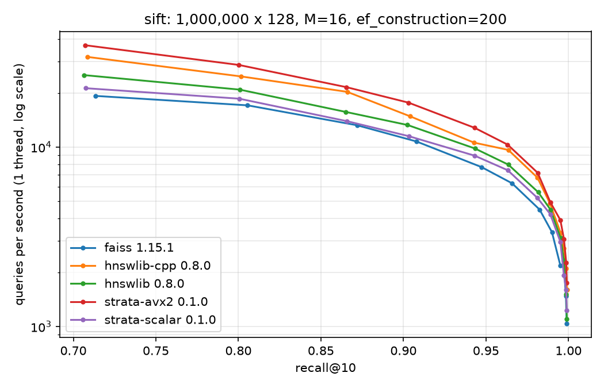
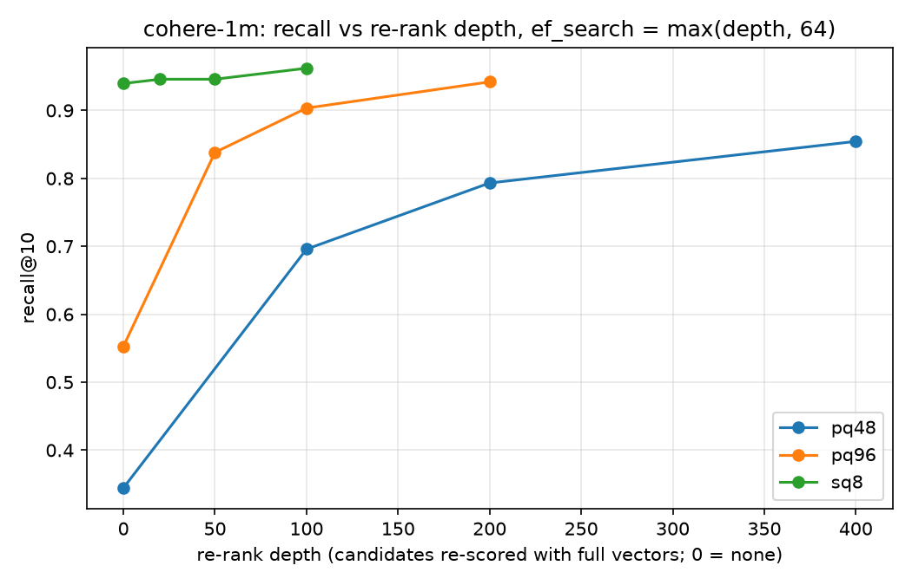

# StrataDB

Vector search engine in C++20, written from scratch: HNSW index, SIMD distance
kernels, SQ8/PQ compression with re-ranking, and crash-safe storage (write-ahead
log, checksummed snapshots, recovery). hnswlib and FAISS are used only as benchmark
baselines.

## Results

| | |
|---|---|
| HNSW, SIFT-1M | 12,807 queries/s at recall@10 = 0.943 (hnswlib: 10,582) |
| p99 latency, SIFT-1M | 121 us (hnswlib: 167 us) |
| AVX2 kernels | 2.0x to 3.2x vs scalar; 1.43x end to end |
| SQ8, Cohere-1M (768-d) | 4x smaller vectors, recall@10 0.961 with re-ranking, 22% higher queries/s |
| PQ, Cohere-1M | 32x smaller vectors, recall@10 0.955 with re-ranking (0.575 without) |
| Group commit | 9,702 durable inserts/s at 16 threads, 7.9x one-sync-per-insert |
| Kill-9 crash test | 16,000 crashes, 0 acknowledged inserts lost |
| Fuzzing | log and snapshot readers, 1 hour each with ASan, 0 crashes |
| Exact search | identical to FAISS on SIFT-1M (top-100) and Cohere-1M (top-10) |





## Components

- **HNSW**: paper's neighbor-selection heuristic, flat layer-0 link array, per-node
  locks for concurrent inserts, neighbor prefetching.
- **Distances**: scalar, auto-vectorized, AVX2 and AVX-512 kernels, chosen at startup.
- **Compression**: SQ8 and PQ (k-means++), search on codes, re-rank with full vectors.
- **Storage**: write-ahead log with group commit, CRC32C-checked snapshots, atomic
  file replacement, MANIFEST, recovery.


## Build

CMake 3.25+, Ninja, GCC 14+ or Clang 18+, Linux x86-64.

```bash
cmake --preset release
cmake --build --preset release
ctest --preset release
```

## Usage

```cpp
#include "strata/database.h"

auto db = strata::Database::create(
    "my-db", std::make_unique<strata::HnswIndex>(128, strata::Metric::L2, 1'000'000));

strata::RowId first = db->insert(vectors);  // n * 128 floats; durable on return

std::vector<strata::RowId> ids(10);
std::vector<float> distances(10);
db->search(query, 10, 64, ids, distances);  // k = 10, ef_search = 64

db->checkpoint();                           // snapshot + drop covered log
auto reopened = strata::Database::open("my-db");
```